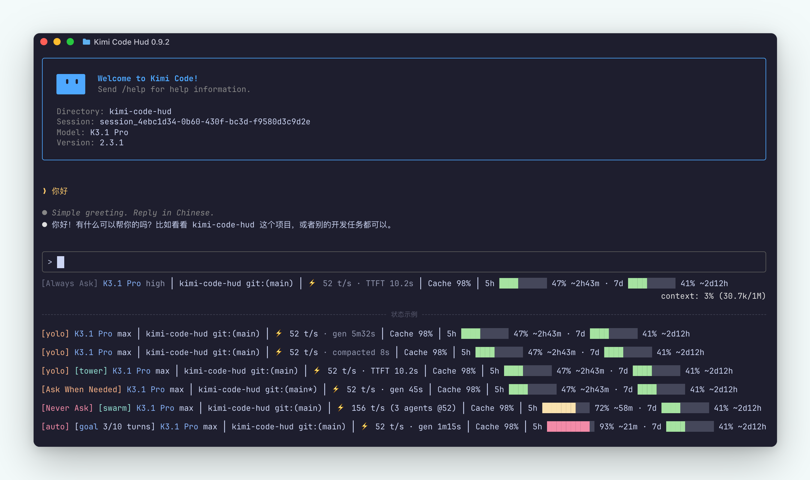

# kimi-code-hud

[](LICENSE) [](https://github.com/FinbackYu/kimi-code-hud/releases)

[中文](README.md) · [Changelog](CHANGELOG.md) · [Issues](https://github.com/FinbackYu/kimi-code-hud/issues)



A custom status line (HUD) for the [Kimi Code CLI](https://www.kimi.com/) — a zero-dependency Node.js script that shows model & thinking effort, git branch, generation speed (TPS / TTFT), compaction timers, recent-request cache hit rate, Kimi managed-subscription usage, and supported third-party provider balances, subscription usage windows, or session-cost estimates in the TUI footer. Rendering is bounded by the host's 300ms deadline, with the HUD holding itself to a tighter 220ms internal per-frame budget (boundaries in [How it works](#how-it-works)); all errors degrade silently, and even a timed-out frame falls back host-side, so the TUI is never blocked.

## Install

Requires Node.js ≥ 18 (global `fetch`). Zero npm dependencies. See [Supported environments](#supported-environments) below for the runtime, OS, and host support policy.

In the Kimi Code TUI, run:

```
/plugins install https://github.com/FinbackYu/kimi-code-hud
```

- **Restart or start a new session** to activate: the plugin's `SessionStart` hook points `tui.toml`'s `[status_line]` at the plugin's managed copy and repairs that entry on every session start;
- Toggle: select it in the `/plugins` panel and press `Space`, or run `/plugins disable kimi-code-hud` / `/plugins enable kimi-code-hud`;
- If you already configured your own `[status_line]` command, the hook leaves it untouched;
- **Update**: run the install command again — the managed copy is replaced in place and the status line picks up the new version within ~1 second.

## Supported environments

| Tier | Scope | Verification |
|---|---|---|
| Recommended runtimes | Node.js LTS lines inside their upstream maintenance window (at the time of writing, 22 / 24) | The target of day-to-day development and release verification |
| Best-effort runtimes | Every version meeting the **Node.js ≥ 18** minimum (the minimum is unchanged) | Releases past their upstream End-of-Life (e.g. 18 / 20) are not proactively tested; issues there are handled on a best-effort basis |
| Operating systems | macOS / Linux / Windows | macOS is the maintainer's primary development and dynamic-verification environment; Linux is covered by the automated CI suite (actual matrix: [`.github/workflows/test.yml`](.github/workflows/test.yml)); Windows is best-effort — the Git probe already resolves a trusted executable the Windows way (including `PATHEXT`, see [KI-7](KNOWN_ISSUES.md#ki-7-the-git-dirty-probe-used-a-bare-executable-name-before-trust)), and **the HUD was dynamically verified on a real Windows 11 + Windows Terminal host on 2026-09-18** (per-frame rendering, line 1 refresh, footer line 2 ownership, quota refresh, and cold-start latency under fullscreen mode in a real PTY — recorded on 2.0.0 with the pre-2.1.0 `KIMI_CODE_TUI_FULL_SCREEN=1` switch, now replaced by `tui_mode = "fullscreen"` in `tui.toml`; evidence in [KI-8](KNOWN_ISSUES.md#ki-8-experimental-fullscreen-mode-lacks-a-live-hud-verification)); window resize, `/reload-tui`, and failure-frame fallback are still unverified |
| Kimi Code host | Source/fixture baseline **2.3.1**; live TUI acceptance pending | Per-release contract audits with pinned upstream commits live in [CAPABILITIES.md](CAPABILITIES.md) |

Changes to the CI matrix are changes in test coverage, not in the support contract: adding or removing matrix entries never widens or shrinks the support statements above — this section is the contract. The interactive cross-OS host matrix (real TUI, terminal emulators, plugin lifecycle) now has its Windows row (Windows 11 + Windows Terminal, see [KI-8](KNOWN_ISSUES.md#ki-8-experimental-fullscreen-mode-lacks-a-live-hud-verification)); macOS Terminal and Linux PTY rows are still being filled in.

## Configuration

The HUD keeps its own settings in `~/.kimi-code-hud/config.json` (JSON; unknown keys are tolerated, and a missing or malformed file falls back to the defaults wholesale). The environment variable of the same setting wins over the config file.

### config.json

| Key | Values | Default | Meaning |
|---|---|---|---|
| `layout` | `"normal"` / `"compact"` | `normal` | Layout tier; lines wider than 200 visible characters degrade normal→compact automatically |
| `permissionNames` | `"official"` / `"short"` | `official` | Permission badge wording. `official` mirrors the host's 0.40+ display names (`[Always Ask]` / `[Ask When Needed]` / `[Never Ask]`); `short` keeps the compact badges (`[manual]` / `[yolo]` / `[auto]`). Unknown values fall back to the default |
| `disabled` | `true` | (absent = enabled) | The disable flag. No need to edit it by hand |

```json
{ "layout": "normal", "permissionNames": "official" }
```

### Environment variables

| Variable | Values | Meaning |
|---|---|---|
| `KIMI_HUD_LAYOUT` | `normal` / `compact` | Layout override; wins over the config file |
| `KIMI_HUD_PERMISSION_NAMES` | `official` / `short` | Permission badge wording override; wins over the config file |
| `KIMI_HUD_THEME` | `dark` / `light` / `auto` | Pin the color theme; by default follows the top-level `theme` in `tui.toml` |
| `NO_COLOR` / `KIMI_HUD_NO_COLOR` | presence | Disable all ANSI colors |
| `KIMI_HUD_HOME` | directory | Override the HUD's own config and cache root (default `~/.kimi-code-hud`) |
| `KIMI_CODE_HOME` | directory | Override the Kimi Code data root (default `~/.kimi-code`; every `~/.kimi-code` path in this README means this default) |

With `KIMI_HUD_THEME=auto` (or unset with no host `theme`) the palette is resolved from `COLORFGBG` with a dark fallback — a status line can't run the host's OSC 11 query on the 300ms hot path; custom theme names fall back to dark. Dark uses a fixed Catppuccin Mocha truecolor palette (`#A6E3A1`/`#F9E2AF`/`#F38BA8` for the green/yellow/red bars), including badges, muted values and the bar track, so terminal ANSI palette remapping cannot change its hues. On light, badges (model name, `[plan]`, `[Ask When Needed]`, `[swarm]`, `[tower]`, `[Never Ask]`) render bold, the amber/teal are brighter than the host defaults (`#D97706`/`#14B8A6`), and the quota bars use calmer truecolor hues (`#B91C1C`/`#D97706`/`#0E7A38`) instead of glaring ANSI red.

### Permission badges

- Official wording (default): `[Always Ask]` (manual — gray-blue, dark `#6C7086` / light `#7D92B8`, quieter than the default foreground and always present so the left edge stays put), `[Ask When Needed]` (yolo — peach on dark, amber on light), `[Never Ask]` (auto — pink on dark, bright red on light, for contrast with yolo);
- `short` wording renders `[manual]` / `[yolo]` / `[auto]` with the same color rules.

## Temporary off / uninstall

To fall back to the built-in status line temporarily: `/plugins disable kimi-code-hud`, and `/plugins enable kimi-code-hud` to restore it.

Uninstall: `/plugins remove kimi-code-hud` — the managed copy clears its own `tui.toml` entry on its next run. **`/reload-tui` or a new session applies the change** (the host replays the last custom frame meanwhile).

## Segment details

The precise rules per segment (sample acceptance, wire derivation paths, fail-closed boundaries, persisted files) live in [CAPABILITIES.md](CAPABILITIES.md). Highlights:

- Speed samples only accept `step.end` rows with ≥250ms of streaming and ≤1000 t/s; the median covers at most the freshest 5 samples within 10 minutes — warmup and expired windows render dimmed, and a model change restarts the warmup;
- Model/thinking prefers the wire (`profile.bind`, in-session switches' `config.update`, and every request's `llm.request`), and only wire records render the effort in the default color; in the lazy-start window before wire rows arrive it resolves the global `config.toml`, and every config-derived value — an explicit `[thinking].effort` key included — stays muted, because the top effort tier is never persisted by the host and config can silently lag the current choice; the resolution is pinned by the per-session snapshot `~/.kimi-code-hud/sessions/thinking-<sessionId>.json` together with the config basis it was derived from, so config edits re-resolve, and wire-confirmed sessions are immune to another session's `/effort` rewriting the global config. Before the first wire row the `max` tier can only show the model default or the previous value ([KI-5](KNOWN_ISSUES.md#ki-5-lazy-start-effort-follows-configtoml-where-the-top-effort-tier-is-never-persisted));
- goal / swarm / tower states are folded from the main agent wire's `goal.*` / `swarm_mode.*` / `tower_mode.*` events; background-task badges merge `task.started` / `task.terminated` ops with the `tasks/<taskId>.json` sidecars (fresher record wins) and count `running` only (with the resumed-subagent exception for a `lost` mark followed by fresh writes — upstream issue MoonshotAI/kimi-code#3350);
- Quota renders and refreshes only for models attributable to `managed:kimi-code`; provider balances/costs/usage windows fail closed on unknown currency, custom proxies, unknown models, mixed-provider ledgers, or a display name shared across providers;
- Session cost is computed locally against the official price tables checked on **2026-08-09**, always `≈` (no server-side tool fees, taxes, or discounts); DeepSeek cache-hit tokens are conservatively priced as misses until the host maps that field, so its estimate can run high;
- Usage coloring: <60% green / <85% yellow / ≥85% red; lines wider than 200 visible characters degrade normal→compact automatically.

## How it works

Once per second the host pipes a JSON snapshot to stdin (capped at 1 MiB with a 150ms timeout) and the **first line** of the command's stdout takes over footer line 1 (line 2 is always drawn by the host and cannot be taken over). **300ms** is the host deadline: it bounds the whole child-process lifetime, Node.js startup included, and the host kills the process tree on timeout. Under that ceiling the HUD holds every frame's work to a **220ms** internal budget (timed from the script's logic entry, excluding Node startup), leaving headroom for the host's scheduling and fallback handling. The budget is cooperative: the HUD checks remaining time between steps and stops early, but synchronous I/O already in flight cannot be interrupted — a single slow read can at worst overrun the internal budget, caught by the host's 300ms deadline. On failure/timeout/empty output the host renders the built-in line or replays the last good frame, so a stale frame may stay visible for a while after a timeout (see [KI-4](KNOWN_ISSUES.md#ki-4-a-failed-command-can-leave-a-stale-frame)) — the script degrades silently on every error path and never logs anything (the single deliberate non-zero exit is the managed copy of a disabled/removed plugin stripping its own `tui.toml` entry, which is how the on/off switch works).

Four data sources: the stdin snapshot and a cross-process cached Git probe (cwd stored only as a SHA-256, 15s TTL); incremental parsing of the session's `wire.jsonl` files (main + every subagent, content-free, cursors and counters persisted under `~/.kimi-code-hud/sessions/`, where files written by earlier versions migrate automatically the next time their session is touched; session state idle for over 30 days and orphaned `*.tmp-*` temporaries from killed processes are swept once a day by the SessionStart hook); the official `/usages` quota API (60s cache plus detached background refresh, dual-region via the oauth host); and provider official balance/usage APIs with locally priced cost estimates (cached isolated by provider + key fingerprint).

## Provider balance & usage

Provider balances and usage windows are selected by the **official host of the provider's `base_url`**, never by the provider name. When `base_url` points at an official host from the matrix below (https, default port, no userinfo; some adapters also pin a path), the HUD calls that provider's fixed official endpoint with the provider's own credential and renders `Label Balance $N.NN` (balance) or `Label 5h ▓ N%` (usage window, with the managed quota's gauge bar, percentage and reset countdown). The provider name only picks the local cache bucket and the diagnostic label, so renaming a provider changes nothing. Proxies, custom gateways and look-alike suffixes never match: the segment hides silently and the API key is never forwarded.

| Adapter | Official host (`base_url`) | Shape | Notes |
|---|---|---|---|
| `deepseek` | `api.deepseek.com` | `balance` | the same balance response supplies the currency for the local Session Cost |
| `opencode-go` | `opencode.ai` | `windows` | 5h / 7d / mo subscription windows; subscription usage is not a cost estimate |
| `zhipuai-coding-plan` | `open.bigmodel.cn`, `api.z.ai` | `windows` (CN can fall back to `balance`) | an unusable plan renders `Zhipu Balance` in the CN region; the international region has no balance endpoint |
| `moonshot` | `api.moonshot.ai` (USD), `api.moonshot.cn` (CNY) | `balance` | the host decides the currency; an account in arrears shows 0 because the contract carries no negative balance |
| `minimax` | `api.minimax.io`, `api.minimax.cn`, `api.minimaxi.com` | `windows` or `balance` | an `sk-api-*` pay-as-you-go key reads the balance; every other subscription key reads the token-plan windows |
| `synthetic` | `api.synthetic.new` | `windows` | 5h / 7d usage plus a 1h search allowance |
| `chutes` | `llm.chutes.ai`, `api.chutes.ai`, plus any single `<label>.chutes.ai` subdomain | `windows` | 4h / 1d / mo; the route publishes no schema, so an unreadable payload hides instead of guessing |
| `openrouter` | `openrouter.ai` (path `/api/v1`) | `windows` | reports the key's spending cap, not a prepaid balance; `/credits` requires a management key, which this tool does not use |
| `deepinfra` | `api.deepinfra.com` | `balance` | prepaid credit and debt fold into one USD balance; an account that cannot spend is marked unavailable |
| `venice` | `api.venice.ai` | `balance` or `windows` | the route requires an ADMIN key, so an inference key answers 401 and hides silently; DIEM accounts render a `1d` allowance window |
| `ollama` | `ollama.com`, `www.ollama.com`, `api.ollama.com` | `windows` or `balance` | Ollama Cloud accounts only; a local `ollama serve` has no balance concept |
| `command-code` | `api.commandcode.ai` | `windows` or `balance` | 5h / 7d allowances plus the mo subscription cycle, degrading to the remaining USD credit |
| `clinepass` | `api.cline.bot` | `windows` | 5h / 7d / mo; hides when the account has no ClinePass subscription |
| `kilo` | `ai-gateway.kilo.ai`, `api.kilo.ai` | `balance` | console tRPC prepaid credit; the route is undocumented, so an unexpected shape hides |
| `vercel-ai-gateway` | `ai-gateway.vercel.sh` | `balance` | `/v1/credits`; team budgets need a separate Vercel access token, which this tool does not use |

Credentials follow the host's own rules: a provider table declares either `api_key` or — on Kimi Code 2.0.1+ — an `api_key_env` naming an environment variable (mutually exclusive). The HUD re-reads the variable by name on every resolution and never stores or logs its value. Nothing renders before the first detached refresh lands; a 401/403 clears the old cache and hides, while transport failures back off. A balance and the local `Session Cost ≈` are independent facts — the balance comes from the official endpoint, the cost from the local price table — and never substitute for each other. When models under several providers share one `display_name`, a frame without the wire alias cannot attribute the provider and the segment hides by design.

Manual troubleshooting: `node ~/.kimi-code/plugins/managed/kimi-code-hud/bin/kimi-hud.mjs --refresh-provider-usage <provider name>`, then inspect `~/.kimi-code-hud/provider-usage/`.

## Capabilities & known issues

- [Capabilities](CAPABILITIES.md): coverage of Kimi Code 2.3.1's line-1 slots, data sources, and readable-but-unrendered Cache/token/goal/task/Git information;
- [Known issues](KNOWN_ISSUES.md): open Git, terminal-width, stale-frame, and fullscreen verification gaps with acceptance criteria.

## Privacy & security

- The Kimi access token is read locally from `~/.kimi-code/credentials/` (the CLI renews it; this tool never writes it) and is only used for the official `api.kimi.com` / `api.kimi.ai` quota endpoints; a provider's API key is read only when that provider's `base_url` selects its official host (see [Provider balance & usage](#provider-balance--usage)) and is only sent to that provider's fixed official endpoint, with the CN GLM plan-unavailable fallback calling the fixed `www.bigmodel.cn` balance endpoint;
- Neither credential is written to logs, caches, or output; provider-usage caches contain only a one-way SHA-256 fingerprint and normalized balance or usage-window facts;
- All dynamic display text is stripped of OSC, CSI, and C0/DEL/C1 control characters before the HUD adds its own ANSI styling; HUD-generated sequences bypass that sanitizer;
- Session cost is computed entirely locally without an extra API-key request; the persisted ledger contains only model aliases and four token counters, never session content.

## FAQ

**Nothing changed?** Make sure you ran `/reload-tui` or restarted; check `echo '{}' | node ~/.kimi-code/plugins/managed/kimi-code-hud/bin/kimi-hud.mjs` prints a line.

**No TPS segment?** Only one state hides TPS entirely: no valid `step.end` sample yet (a brand-new session mid-first-step — TTFT shows on its own meanwhile). Warmup with fewer than 3 samples, an expired window, and a model change all render a muted provisional reading or the last median; normal brightness resumes at 3 valid samples. A task that just settled is the exception — the last median and the `gen`/`compacted` timers keep their normal brightness for a one-minute settle grace before fading to muted. If TTFT is also absent, this session has not completed a `step.end` yet.

**No Cache segment?** It stays omitted while no complete `step.end` usage falls within the last 30 minutes. The first valid step is enough to show it; five samples are not required. The value is token-weighted over the newest five main-agent model steps inside that 30-minute window rather than cumulative session history. Older steps stop counting, and a new prompt does not revive them. After upgrades, a bounded restoration (at most 1 MiB of the wire tail) rebuilds the recent window once.

**No quota segment?** First check whether the active model comes from a third-party provider (models added via `/provider` never show quota — the API covers the managed subscription only) and whether its model config resolves explicitly to `managed:kimi-code`; an unknown provider fails closed. For managed models, the section is omitted until a valid cache exists. The 0.43.1 response serves ratios under `usages`: HUD shows the reported 5h, 7d and mo windows, with a kimi/code split when both monthly components are present. Upgrading invalidates old quota caches; the next successful refresh restores the display. Run `node ~/.kimi-code/plugins/managed/kimi-code-hud/bin/kimi-hud.mjs --refresh-quota` (silent) and check `~/.kimi-code-hud/quota.json`.

**No provider balance or usage windows?** The HUD selects an adapter by the **official host of the provider's `base_url`**, not by the provider name: check the [support matrix](#provider-balance--usage) first, then confirm the credential — an `api_key`, or — on Kimi Code 2.0.1+ — an `api_key_env` naming a non-empty environment variable (mutually exclusive; the HUD re-reads the variable by name on every resolution and never stores or logs its value; an unset or empty variable stays hidden by design, with no fallback to another credential). Nothing renders before the first detached refresh lands; a 401/403 clears the old cache and hides, while transport failures back off. A balance and the local `Session Cost ≈` are independent: once the complete usage ledger is ready, cost can appear alone with a known currency even when the balance is unavailable. Run `node ~/.kimi-code/plugins/managed/kimi-code-hud/bin/kimi-hud.mjs --refresh-provider-usage <provider name>` silently and then inspect `~/.kimi-code-hud/provider-usage/`.

**No DeepSeek / OpenAI / Anthropic Session Cost?** The active model must use the corresponding official direct service and a model ID in the built-in price table. No partial number is shown before all wires catch up; if the same session contains nonzero usage from another provider or an unresolved model, the whole estimate hides. This is a local estimate for the current session, not an API balance and not a ChatGPT / Claude subscription allowance.

**Where did the Context segment go?** The plugin no longer draws its own Context segment — read the host-drawn line 2 (`context: N% (tokens/max)`), which can never be taken over by a plugin.

## Development

```bash
npm test        # node --test
```

## License

Released under the [MIT License](LICENSE). © 2026 FinbackYu
